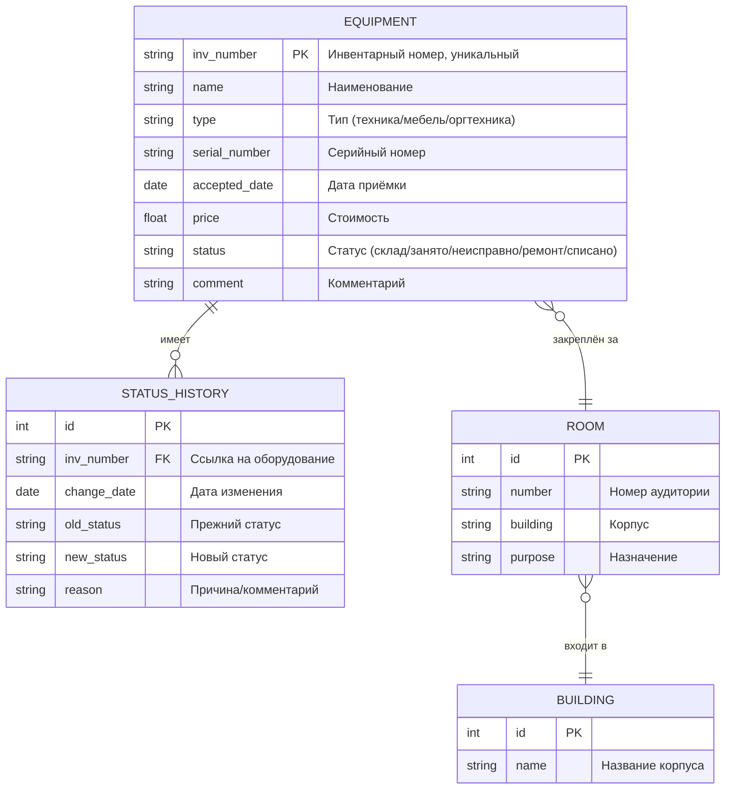

#gazyava - консольная система учета инвенторя, позволяющаяя фиксировать статус оборудования, закреплять его за аудиториями и формировать отчеты о наличие.

Установка и первое включение: 
1. Получите установочный образ. Скачайте ISO-образ нужной системы. 
2. Подготовьте загрузочный носитель. Записать ISO на флешку или DVD. Для этого на Windows удобно использовать Rufus, на Linux и macOS - Balena Etcher. Важное предупреждение: при записи все данные на носителе будут стёрты. -
3. Загрузитесь с носителя. При включении компьютера зайдите в BIOS/UEFI и в меню загрузки выберите ваш носитель (флешку, диск). Иногда для этого нужно успеть нажать определённую клавишу (F2, F12 и др.) прямо в начале загрузки. 
4. Запустите консольный установщик. После загрузки вы попадёте в окружение live-системы. В некоторых дистрибутивах (например, Arch Linux) прямо в терминале можно запустить специальный скрипт-установщик 
5. Пройдите этапы установки.
6. Настройка сети. Часто нужно указать параметры подключения (IP, маска, шлюз). 
7. Создание пользователей и паролей.
8. Установка пакетов. 
9. Завершение и первая загрузка. После успешного завершения установки система предложит перезагрузиться. При первой загрузке нужно будет создать учётную запись пользователя и, возможно, настроить окружение.

Назначение системы
Программа предназначена для учёта оборудования и позволяет: вести базу инвентаря - компьютеров, проекторов, принтеров, клавиатур, мышек и т.д.
фиксировать статус каждой единицы оборудования;
закреплять оборудование за конкретными аудиториями и за ответственными лицами;
формировать отчёты о наличии: свободное, занятое, неисправное оборудование, распределение по кабинетам.

Структура: 
После запуска пользователь видит главное меню:

text
 СИСТЕМА УЧЁТА ИНВЕНТАРЯ 
1. Добавить оборудование
2. Просмотреть весь инвентарь
3. Поиск оборудования
4. Изменить статус оборудования
5. Закрепить оборудование за аудиторией
6. Освободить оборудование
7. Списать оборудование
8. Отчёты
9. Справочник аудиторий
0. Выход
Выберите пункт.

